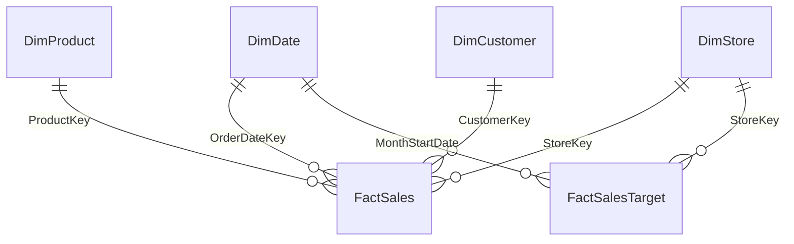

# 01 · Retail & E-commerce Sales Profitability

**Live dashboard:** https://navneet2394.github.io/bi-projects/#retail &nbsp;·&nbsp; **Tools:** Power BI · DAX · Power Query · SQL Server

> **Problem:** sales were growing at double digits, but margin was not following. Regional managers
> worked from separate spreadsheet packs, and nobody could see where growth was being bought with discounts.
> **Outcome:** a single, row-level-secured sales model that shows where profit is made and lost, by
> channel, region, category, discount level and customer.

## Business context
*Northwind Omni Retail* (fictional) sells electronics, home, fashion, grocery and beauty products through
22 stores in four regions (North, West, South, East) and an online store. FY2024 was the first year with a
formal monthly sales plan by store and category. Leadership asked for one trusted view of performance against that plan.

| Stakeholder | Question they need answered | Report page |
|---|---|---|
| CEO / CFO | Are we on plan, and is growth profitable? | Executive Overview |
| Head of E-commerce | Is online growth worth its discounts and returns? | Channel & Region |
| Regional managers | How is my region doing against plan? (own region only, via RLS) | Target Tracker |
| Category managers | Which categories and products earn the margin? | Category & Product |
| Pricing team | Where do discounts stop paying back? | Discounts & Returns |
| CRM team | Which customers are worth retaining? | Customers |

## Executive summary · 2025

| Net sales | vs 2024 | vs plan | Gross margin | Return rate | Orders | Avg order value |
|---:|---:|---:|---:|---:|---:|---:|
| **₹34.79 Cr** | +12.7% | 101.7% | 22.0% | 5.2% | 21,515 | ₹16,172 |

The business beat its plan (101.7%) and grew +12.7%, but gross margin stayed flat at
22.0% for the third year: growth came from the lowest-margin channel and categories.

## Key findings
1. **Online drives the growth, at a lower margin.** Online grew +26.2% and delivered
   107.0% of plan, but earns 19.2% margin against
   22.9% in stores, because of a 10.2% average discount
   (stores 6.1%) and 8.0% returns (stores 4.4%).
2. **East is the only region going backwards.** Net sales −2.5% year on year and
   90.3% of plan. East discounts at 10.1% on average, twice West
   (4.7%), yet still loses volume, so discounting is not fixing the problem.
3. **Revenue and profit come from different categories.** Electronics is 47.0% of sales but
   only 23.2% of gross margin (10.8% margin). Fashion is
   20.6% of sales and 41.8% of gross margin (44.7%).
4. **Discounts above 15% destroy margin.** Margin falls from 27.1% at full price to
   14.9% at 15% off and 9.5% at 20% off. 15.2% of sales were made at 15% or more.
5. **Fashion returns are the biggest leakage.** 10.1% of fashion sales come back
   (13.0% online vs 8.9% in store), worth ₹0.80 Cr in 2025.
6. **Corporate and loyal customers are the most valuable.** Corporate orders average ₹30,102
   (2.2× consumers) at 24.6% margin. Platinum members
   order 10.3 times a year, against 2.7 for non-members.

## Recommendations
- **Cap discounts at 15%** without category-head approval. Even moving half of the deeper-discount sales back to
  10% would recover margin on 15.2% of revenue.
- **Turn East around with a store-level review** (range, staffing, local competition) instead of further price cuts.
- **Grow online on margin, not only volume:** fewer blanket promotions, and fashion size guides and fit tools to cut returns.
- **Use Fashion and Home to fund growth** (shelf space, marketing), and sell Electronics with attachments
  (accessories, extended warranty) to lift its margin.
- **Build a corporate sales programme and push loyalty enrolment,** since these customers buy more often and at better margin.

## Data
| Item | Detail |
|---|---|
| Source | Point-of-sale and e-commerce order lines, product, store and customer masters, monthly sales plan |
| Period | Jan 2023 – Dec 2025 · INR |
| Volume | 99,919 raw order lines → 99,712 after cleaning · 180 products · 23 stores · 6,000 customers |
| Grain | One row per order line; plan per month × store × category (2024–2025) |
| Data quality | **207 duplicate lines** from a source batch loaded twice (2–3 Mar 2025) removed; **420 guest-checkout lines** without a customer mapped to an *Unknown* member |

The dataset is synthetic, modelled on an Indian omni-channel retailer. No employer or client data is used.

## Data model

Star schema with single-direction relationships. The plan is at month × store × category grain, so the category
filter reaches it through `TREATAS` instead of a bi-directional relationship. `SecurityUserRegion` drives dynamic row-level security.

## Technical highlights
- **40+ DAX measures** in display folders ([`dax/measures.dax`](dax/measures.dax)): net vs gross sales, margin, YTD, YoY and rolling
  periods, target attainment, new vs returning customers, Pareto/ABC, Top-N, a dynamic metric selector.
- **Power Query** ([`powerquery/queries.pq`](powerquery/queries.pq)): parameterised loads, de-duplication and Unknown-member handling,
  plus a SQL variant with query folding and incremental refresh.
- **Dynamic RLS:** one role, filtered by the signed-in user's region ([`docs/RLS.md`](docs/RLS.md)).
- **SQL Server layer:** star-schema DDL, columnstore fact table, staging and validation queries ([`sql/`](sql/)).

## Reconciliation
Every figure in this README is calculated three ways (DAX in the report, SQL in
[`sql/02_validation_queries.sql`](sql/02_validation_queries.sql), and Python in [`../scripts/compute_kpis.py`](../scripts/compute_kpis.py)), and all three agree.

| Year | Net sales | Gross margin % | Return rate | Orders | AOV | vs plan |
|---|---:|---:|---:|---:|---:|---:|
| 2023 | ₹27.59 Cr | 22.0% | 5.3% | 17,100 | ₹16,134 | n/a |
| 2024 | ₹30.87 Cr | 22.1% | 5.3% | 19,143 | ₹16,125 | 101.3% |
| 2025 | ₹34.79 Cr | 22.0% | 5.2% | 21,515 | ₹16,172 | 101.7% |

## Files
```
data/         CSV extracts (raw FactSales includes the duplicate batch and guest orders)
dax/          measures.dax
powerquery/   queries.pq
sql/          01_schema.sql, 02_validation_queries.sql
docs/         REPORT_SPEC.md (page-by-page visuals and expected values), BUILD_GUIDE.md, RLS.md, DATA_DICTIONARY.md
```
