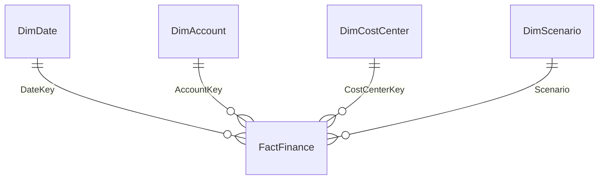

# 02 · Finance P&L: Budget vs Actual vs Forecast

**Live dashboard:** https://navneet2394.github.io/bi-projects/#finance &nbsp;·&nbsp; **Tools:** Power BI · DAX (calculation groups) · Power Query · SQL Server

> **Problem:** the monthly close pack was assembled by hand in Excel, so the variance commentary arrived late
> and cost-centre owners argued about the numbers.
> **Outcome:** a P&L model where revenue and cost of goods come straight from the sales ledger (Project 01),
> the budget comes from the sales plan, and every variance drills to account and cost centre.

## Business context
Same company as Project 01. Finance (FP&A) closes monthly and reports Actual vs Budget to the CFO and
cost-centre owners; a rolling forecast was added after the June 2025 close. Retail cost centres map one-to-one to
the sales regions, so a regional sales story is visible in the P&L.

| Stakeholder | Question | Report page |
|---|---|---|
| CFO | Are we on budget, and what will the year land at? | P&L Statement, Outlook |
| FP&A | What explains the variance? | Variance Bridge |
| Cost-centre owners | Is my spend within budget? | Cost Centre Accountability |

## Executive summary · Jan–Dec 2025

| | Actual | Budget | Variance |
|---|---:|---:|---:|
| Revenue | ₹35.28 Cr | ₹34.70 Cr | +1.7% |
| Gross profit (margin) | ₹7.47 Cr (21.2%) | ₹7.54 Cr (21.7%) | −1.0% |
| EBITDA (margin) | ₹2.86 Cr (8.1%) | ₹3.01 Cr (8.7%) | −5.1% |
| **Net income** | **₹1.71 Cr** | **₹1.83 Cr** | **−6.4%** |

**Revenue beat budget, but net income missed it by 6.4%.** The extra sales were more than
offset by returns, a weaker product margin and festive-season costs.

## Key findings
1. **Gross sales were ₹130.2 L ahead of budget**, driven by online growth (Project 01).
2. **Returns cost ₹70.5 L more than planned.** The budget assumed 3% store and 5% online
   returns; actuals were 4.4% and 8.0%.
3. **Cost of goods sold was ₹59.5 L over plan.** Gross margin was 21.2% against a
   21.7% plan, the cost of the discount-heavy, electronics-heavy mix.
4. **The festive campaign overspent.** Marketing & Promotions ran ₹7.8 L over budget
   (Marketing HQ +5.1% for the year, concentrated in Oct–Nov), and online freight
   was ₹6.3 L over.
5. **People and fixed costs are under control:** salaries, rent, IT and depreciation are all within about 1% of budget.
6. **Latest estimate:** H1 actuals plus the H2 rolling forecast pointed to ₹1.69 Cr net income, close to the ₹1.71 Cr delivered.

## Recommendations
- Re-base the 2026 budget on **actual return rates by channel**, and give e-commerce a returns-reduction target.
- Put a **gross-margin guardrail** on promotions (link to the 15% discount cap in Project 01).
- Approve festive marketing in **stage-gated tranches** tied to weekly ROI, rather than one upfront budget.
- Keep the rolling forecast: it called the year-end result within 0.9%.

## Reconciled P&L · Jan–Dec 2025
| Line | Actual | Budget | Variance | Var % |
|---|---:|---:|---:|---:|
| Revenue | ₹35.28 Cr | ₹34.70 Cr | +₹58.5 L | +1.7% |
| COGS | −₹27.82 Cr | −₹27.16 Cr | −₹65.8 L | −2.4% |
| **Gross Profit** | **₹7.47 Cr** | **₹7.54 Cr** | **−₹7.3 L** | **−1.0%** |
| Operating Expenses | −₹4.61 Cr | −₹4.53 Cr | −₹8.1 L | −1.8% |
| **EBITDA** | **₹2.86 Cr** | **₹3.01 Cr** | **−₹15.3 L** | **−5.1%** |
| D&A | −₹0.45 Cr | −₹0.45 Cr | −₹0.1 L | −0.2% |
| **EBIT** | **₹2.40 Cr** | **₹2.56 Cr** | **−₹15.4 L** | **−6.0%** |
| Finance Cost | −₹0.12 Cr | −₹0.12 Cr | −₹0.2 L | −1.4% |
| **Profit Before Tax** | **₹2.28 Cr** | **₹2.44 Cr** | **−₹15.6 L** | **−6.4%** |
| Tax | −₹0.57 Cr | −₹0.61 Cr | +₹3.9 L | +6.4% |
| **Net Income** | **₹1.71 Cr** | **₹1.83 Cr** | **−₹11.7 L** | **−6.4%** |

Costs are stored as negatives (sign convention), so a positive variance is always favourable.

## Data model

`PnLLayout` is a disconnected table that defines the statement lines and subtotals.

## Technical highlights
- **Sign-convention design:** `PnLSign × NaturalSign` makes every subtotal a single `SUM`; no line-by-line sign logic.
- **P&L layout table** drives subtotal rows (Gross Profit, EBITDA, EBIT, PBT, Net Income) in one matrix.
- **Calculation groups** for MTD / QTD / YTD / FYTD / PY / YoY ([`dax/calculation_groups.md`](dax/calculation_groups.md)).
- **Latest Estimate** measure: actuals for closed months plus forecast for open months.
- **Budget ingestion:** finance's wide Excel template is unpivoted in Power Query ([`powerquery/queries.pq`](powerquery/queries.pq)).
- **Integrated with Project 01:** revenue, returns and COGS are derived from the same order lines, and the budget from the sales plan.

## Data
`FactFinance`: month × account × cost centre × scenario (Actual 2023–2025, Budget 2024–2025, Forecast Jul–Dec 2025), INR.
Synthetic data; no employer or client data. Page-by-page report specification: [`docs/REPORT_SPEC.md`](docs/REPORT_SPEC.md).
