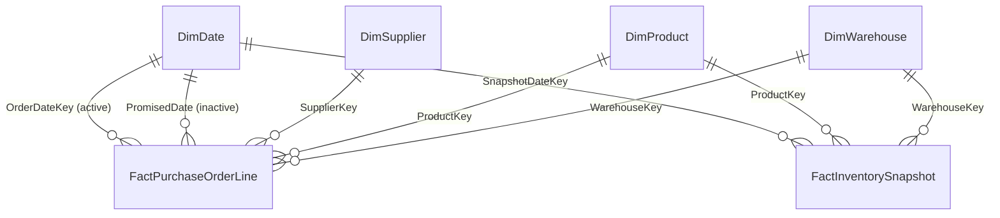

# 03 · Procurement & Supply Chain: OTIF, Supplier Scorecard & Inventory Health

**Live dashboard:** https://navneet2394.github.io/bi-projects/#supply &nbsp;·&nbsp; **Tools:** Power BI · DAX · Power Query · SQL Server

> **Problem:** stores reported empty shelves before the festive season, and procurement had no shared
> measure of supplier performance, so supplier reviews were based on anecdotes.
> **Outcome:** an OTIF (on time, in full) scorecard on every purchase-order line, a ranked supplier view with
> spend at risk, and an inventory view that flags stock-out risk before the peak.

## Business context
Same company and product range as Project 01. Five distribution centres replenish the regions and the online
store from 14 suppliers, domestic and imported. The service-level target is **90% OTIF**.

| Stakeholder | Question | Report page |
|---|---|---|
| Head of Procurement | Which suppliers miss, and how much spend is exposed? | Supplier Scorecard |
| Supply planners | When do deliveries slip? | Service Level |
| DC managers | Where will stock run out? | Inventory Health |
| Buyers | Which PO lines are late right now? | Late PO drill-through |

## Executive summary · 2025

| OTIF | On time | In full | PO lines | Purchase spend | Inventory (31 Dec) |
|---:|---:|---:|---:|---:|---:|
| **80.9%** | 86.2% | 93.7% | 12,232 | ₹25.63 Cr | ₹2.79 Cr |

OTIF has been stuck around 81% for three years, about 9 points below target.
Late delivery, not short delivery, is the main gap: in-full is 93.7%, while on-time is only 86.2%.

## Key findings
1. **Supplier tier predicts performance.** OTIF: Strategic 87.4%, Preferred 76.5%,
   Transactional 67.5%.
2. **Imports are less reliable:** 74.6% OTIF vs 83.8% for domestic suppliers, and late import
   deliveries run several days later.
3. **Deliveries slip before the festive peak.** Deliveries promised in September–October hit 72.5% OTIF,
   against 82.9% in the other months (2024–2025), exactly when stock is needed most.
4. **That shows up on the shelf.** At the end of October 2025, 22.5% of electronics item-DC positions
   were below safety stock, versus 6.7% or less in every other category.
5. **₹5.55 Cr (21.6% of 2025 spend) sits with suppliers below 75% OTIF.** The weakest:
   Delhi Gadget Wholesale (64.3%), Agra Footwear Co (64.9%), Dhaka Garments Export (71.0%).

## Recommendations
- Put the three weakest suppliers on a **90-day improvement plan** with OTIF clauses; dual-source their high-value items.
- **Bring festive purchase orders forward** by the import lead time (4–6 weeks) and raise safety stock on
  A-class electronics for September–October.
- Shift volume from Transactional to Strategic suppliers where price allows; the OTIF gap is about
  20 points.
- Review the scorecard monthly with procurement and share it with suppliers.

## 2025 supplier scorecard
| Supplier | Country | Tier | Category | OTIF | On time | In full | Avg days late (late lines) | Spend |
|---|---|---|---|---:|---:|---:|---:|---:|
| Delhi Gadget Wholesale | India | Transactional | Electronics | 64.3% | 79.7% | 80.3% | 3.0 | ₹1.61 Cr |
| Agra Footwear Co | India | Transactional | Fashion | 64.9% | 83.5% | 76.8% | 3.0 | ₹0.74 Cr |
| Dhaka Garments Export | Bangladesh | Preferred | Fashion | 71.0% | 77.5% | 91.9% | 7.0 | ₹1.21 Cr |
| Kolkata FMCG Traders | India | Transactional | Grocery | 72.1% | 83.0% | 87.2% | 2.9 | ₹0.05 Cr |
| Ningbo HomeWorks | China | Preferred | Home | 72.4% | 75.7% | 95.4% | 7.0 | ₹1.93 Cr |
| Hanoi Digital Components | Vietnam | Preferred | Electronics | 75.8% | 80.6% | 94.5% | 7.6 | ₹3.01 Cr |
| Seoul Beauty Labs | South Korea | Preferred | Beauty | 76.5% | 82.4% | 93.0% | 7.3 | ₹0.13 Cr |
| Shenzhen Brightway Electronics | China | Strategic | Electronics | 79.0% | 83.4% | 95.3% | 7.1 | ₹4.09 Cr |
| Moradabad Kitchenware | India | Preferred | Home | 80.1% | 84.8% | 94.5% | 2.9 | ₹2.01 Cr |
| Herbana Naturals | India | Preferred | Beauty | 85.3% | 89.0% | 95.6% | 3.1 | ₹0.14 Cr |
| Jodhpur Woodcraft | India | Strategic | Home | 86.8% | 90.1% | 96.3% | 3.1 | ₹3.64 Cr |
| Pune Tech Distributors | India | Strategic | Electronics | 88.8% | 91.4% | 97.2% | 3.0 | ₹4.91 Cr |
| Annapurna Foods | India | Strategic | Grocery | 88.8% | 92.3% | 96.4% | 3.0 | ₹0.14 Cr |
| Tiruppur Apparel Mills | India | Strategic | Fashion | 89.6% | 92.2% | 97.1% | 2.9 | ₹2.01 Cr |

## Data model

## Technical highlights
- **Role-playing dates:** order date active, promised and received dates inactive, switched with `USERELATIONSHIP`.
- **Semi-additive inventory:** stock is taken from the last snapshot in the period, never summed across months.
- **Business logic upstream:** OTIF flags are built in a SQL view and in Power Query, not as DAX calculated columns.
- **Supplier score and rank** (OTIF, fill rate, lateness), risk bands and spend-at-risk measures ([`dax/measures.dax`](dax/measures.dax)).

## Reconciliation (OTIF by order year)
| Year | PO lines | On time | In full | OTIF | Spend |
|---|---:|---:|---:|---:|---:|
| 2023 | 12,534 | 86.2% | 93.8% | 80.9% | ₹23.02 Cr |
| 2024 | 13,122 | 86.1% | 93.7% | 80.7% | ₹25.30 Cr |
| 2025 | 12,232 | 86.2% | 93.7% | 80.9% | ₹25.63 Cr |

Matches `sql/01_schema.sql` (reconciliation queries) and `scripts/compute_kpis.py`. Synthetic data; no employer or
client data. Page-by-page specification: [`docs/REPORT_SPEC.md`](docs/REPORT_SPEC.md).
